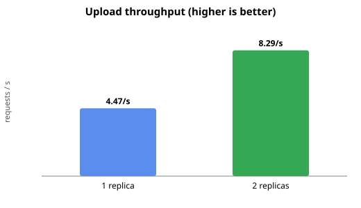
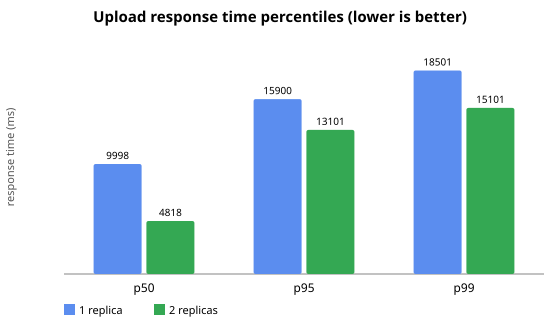

# D4 — File Service replication (1 vs 2 instances)

**Requirement D4:** replicate a service + load test, show improvement in ≥1 metric.

## Setup

- **Workload:** JMeter 5.6.3, 50 concurrent threads, 60 s, repeated multipart upload of a real ~5 MB MP4 (H.264+AAC) through the **Gateway** (`POST /api/files/upload` → `lb://file-service` via Eureka). Plan + scripts in [`load-tests/jmeter/`](../../load-tests/jmeter/).
- **Service under test:** `file-service` (upload is CPU-bound: Tika magic-bytes + `ffprobe` subprocess + S3 PUT per request). Each replica capped at **1 vCPU / 1 GB** (`deploy.resources.limits`), so a 2nd replica genuinely adds compute rather than sharing one over-provisioned JVM.
- **Variants:** `FILE_SERVICE_REPLICAS=1` then `=2` (same compose, only that variable changes). Gateway upload rate-limit raised for the run (`UPLOAD_RL_*`), since it is a separate security control, not the thing under test.
- **Host:** AMD Ryzen 5 5600 (6C/12T), 16 GB; JMeter and the stack share the host (Docker Desktop / WSL2).

## Results (2026-06-10)

| Metric | replicas=1 | replicas=2 | Δ |
|---|---|---|---|
| Throughput (req/s) | 4.47 | 8.29 | **+85 %** |
| Completed uploads (60 s) | 289 | 533 | +84 % |
| Error rate | 0.0 % | 0.0 % | — |
| Avg (ms) | 10 543 | 5 628 | −47 % |
| p50 (ms) | 9 998 | 4 818 | **−52 %** |
| p95 (ms) | 15 900 | 13 101 | −18 % |
| p99 (ms) | 18 501 | 15 101 | −18 % |

**Load-balancer distribution (replicas=2):** the two replicas served 266 vs 267 uploads during the run
(`http_server_requests_seconds_count` per container) — an even ~50/50 round-robin split, confirming the
Gateway/Eureka LB actually used both instances.

## Interpretation

The second replica improved **every** metric. Throughput nearly doubled (+85 %) and median latency
halved (−52 %), exactly as expected for a CPU-bound service capped at 1 vCPU each: with one replica the
50 concurrent uploads queue behind a single core; with two, the LB spreads them across two cores. The
tail (p95/p99) improves less (−18 %) because under saturation both setups still queue — the second
replica raises the ceiling, it doesn't make a saturated system idle. Criterion (≥1 metric improved): met,
with margin.

## Threats to validity

- Client (JMeter) and server share one host, so absolute latencies are inflated; the 1-vs-2 comparison is
  consistent because the only changed variable is the replica count.
- Traffic flows through the Gateway (real LB path) — the Gateway is not the bottleneck here (throughput
  scaled with file-service replicas, which it couldn't if the Gateway were the limit).
- A 60 s run on a shared dev box is a relative comparison, not an absolute capacity benchmark.

## Re-run (2026-10-15)

The re-run uses the same plan and sample: 50 threads, 60 s, one client-credentials token, so one
owner. Settings: `UPLOAD_MAX_CONCURRENT=50`, upload rate limit 10 000, and the quota raised to
500 GB so that it is not the limit under test. It found three problems introduced by later
hardening, all fixed before the final runs, and one host problem:

| Run | Code | replicas | Uploads | req/s | p50 (s) | p95 (s) | Errors | Finding |
|---|---|---|---|---|---|---|---|---|
| r3 | main before #205 | 1 | 268 | 4.02 | 11.3 | 17.5 | 0 % | — |
| r4 | main before #205 | 2 | 224 | 3.25 | 16.2 | 19.0 | 0 % | second replica slower: 19 of 20 DB connections waited on the owner's quota advisory lock, held during the S3 PUT |
| r5 | + #205 | 1 | 113 | 1.35 | 30.4 | 60.1 | 5.3 % | SeaweedFS at its 1 GiB limit; chunk writes timed out |
| r5b | + #205, SeaweedFS 3 GiB (manual) | 1 | 218 | 3.40 | 13.2 | 25.8 | 1.8 % | memory confirmed as the cause |
| r6 | main 3c18ea1 | 1 | 291 | 4.28 | 11.2 | 14.4 | 0 % | host disk throttled (see below) |
| r7 | main 3c18ea1 | 2 | 333 | 5.06 | 8.9 | 17.3 | 0 % | host disk throttled: only +18 % |
| **r8** | **main 1de406d, disk fixed** | **1** | **435** | **7.02** | **6.9** | **10.2** | **0 %** | — |
| **r9** | **main 1de406d, disk fixed** | **2** | **656** | **10.51** | **4.5** | **7.9** | **0 %** | — |

Fixes:
- **#205** moves the S3 PUT out of the quota lock.
- **#206** keeps SeaweedFS volume write tokens valid for 60 s. At 10 s, the cleanup of a timed-out
  chunk got `401 wrong jwt` and left orphaned needles.
- **#207** gives SeaweedFS 2 GiB and `GOMEMLIMIT=1536MiB`. A heap profile after the run showed
  about 410 MB live after GC, while the Go heap had grown to the cgroup limit.

r6/r7 showed only +18 % for the second replica, so they hit a resource the replicas share:
- Mean server time per upload was about 10.8 s with one replica and with two.
- Each file-service replica averaged about 43 % CPU.
- Giving SeaweedFS a second CPU changed throughput by only +9 %.
- Linux PSI in the Docker VM showed `io full` at 17–31 %. During a 35 s load the Docker data
  disk (`docker_data.vhdx` on an NVMe SSD) wrote 1.47 GB with an average write latency of 850 ms.

Each upload writes the 5 MB file twice to that disk, once to the multipart spool and once to the
SeaweedFS volume. A raw `dd … conv=fsync` in a container reached only 106 MB/s. Giving the VM
14 GB instead of 8 GB did not help. Excluding `%LOCALAPPDATA%\Docker\wsl` and the `vmmem`/`vmmemWSL`
processes from Microsoft Defender real-time scanning raised it to 700–770 MB/s. r8/r9 then ran on
the same code with that exclusion and 14 GB for WSL:

| Metric | replicas=1 | replicas=2 | Δ |
|---|---|---|---|
| Throughput (req/s) | 7.02 | 10.51 | **+50 %** |
| Completed uploads (60 s) | 435 | 656 | +51 % |
| Avg (s) | 6.8 | 4.5 | −34 % |
| p50 (s) | 6.9 | 4.5 | **−35 %** |
| p95 (s) | 10.2 | 7.9 | −23 % |
| p99 (s) | 11.3 | 8.9 | −21 % |

The replicas served 741 vs 742 uploads across the warm-ups and r9, with no `wrong jwt`, volume
write timeouts or ffprobe timeouts. Every metric improves, so D4 is met with margin. Absolute
numbers are higher than in June, but the June host conditions were not recorded, so the two
runs compare only within themselves.

On Windows, measure D4 only with the Defender exclusion above. Without it the benchmark measures
antivirus scanning of the virtual disk, not file-service.

Method notes:
- The first run after a fresh `up` is slow (about 1.7 req/s, cold JIT and new SeaweedFS volumes),
  so every variant gets a warm-up run.
- Changing `FILE_SERVICE_REPLICAS` recreates every replica. For several seconds after that, the
  Gateway answered `503 No servers available` until its Eureka cache refreshed: 76 % of the first
  warm-up after scaling. The measured runs had no errors.
- Under the throttled disk, ffprobe timeouts made file-service answer `422 INVALID_FILE` for a
  valid file (50 of 153 requests in one warm-up). Overload is reported as a client error. This
  is tracked separately.

## Reproduce

See [`load-tests/jmeter/README.md`](../../load-tests/jmeter/README.md): generate the sample, bring the
stack up per variant, warm up + verify Eureka shows the expected instance count, then `run-loadtest.ps1 -Label rN`.
